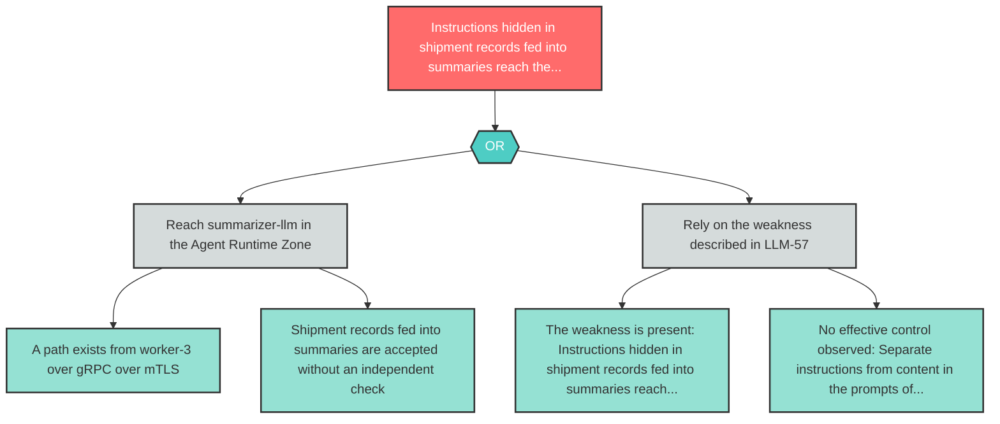

# LLM-57: Instructions hidden in shipment records fed into summaries reach...

**Component**: summarizer-llm | **Risk Level**: Critical | **Finding**: LLM-57

Instructions hidden in shipment records fed into summaries reach the prompt of summarizer-llm and override its system guidance, because content and instructions share one context.

