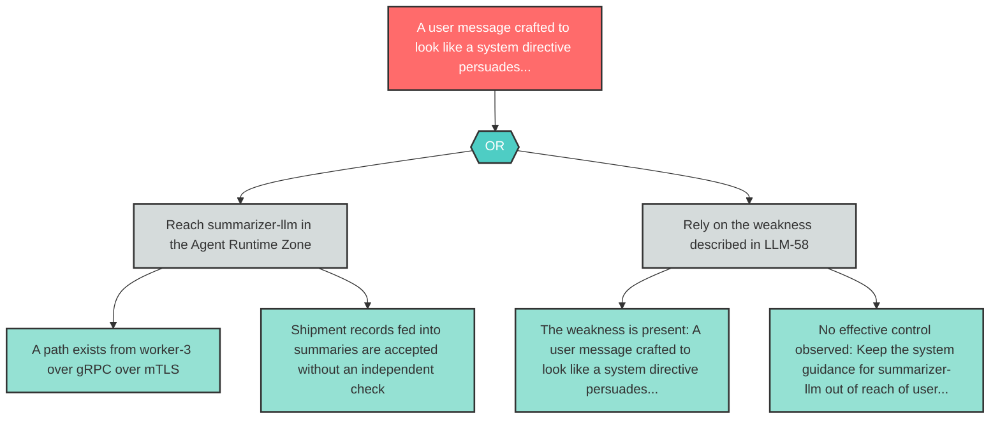

# LLM-58: A user message crafted to look like a system directive persuades...

**Component**: summarizer-llm | **Risk Level**: High | **Finding**: LLM-58

A user message crafted to look like a system directive persuades summarizer-llm to disclose its configuration or ignore its rules.

