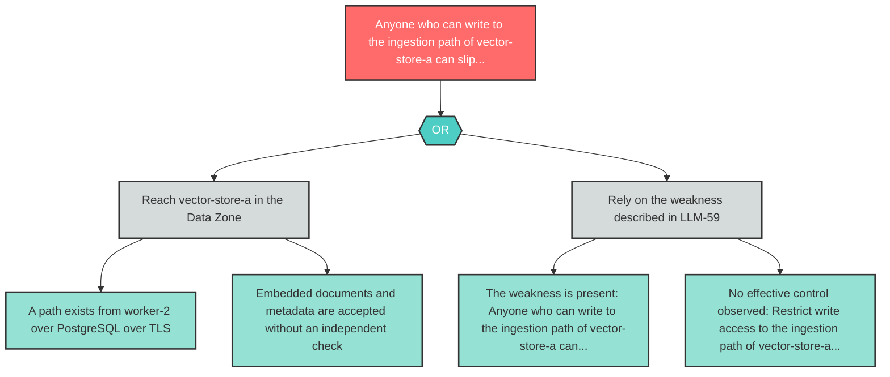

# LLM-59: Anyone who can write to the ingestion path of vector-store-a can...

**Component**: vector-store-a | **Risk Level**: Critical | **Finding**: LLM-59

Anyone who can write to the ingestion path of vector-store-a can slip in documents that contradict authoritative sources.

