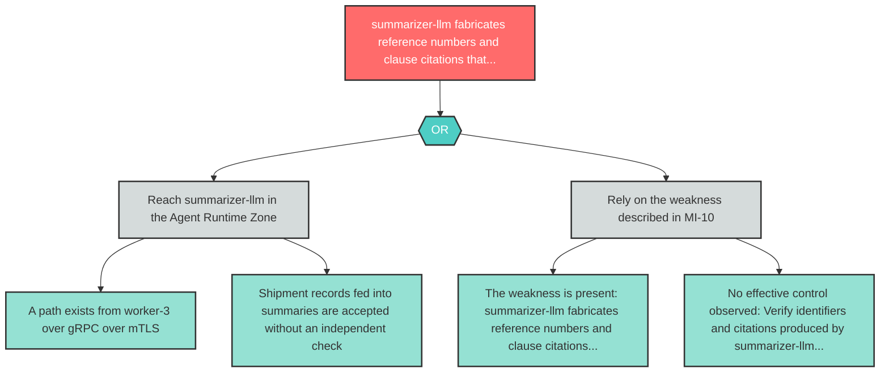

# MI-10: summarizer-llm fabricates reference numbers and clause citations...

**Component**: summarizer-llm | **Risk Level**: High | **Finding**: MI-10

summarizer-llm fabricates reference numbers and clause citations that look real, which operators then paste into official documents.

