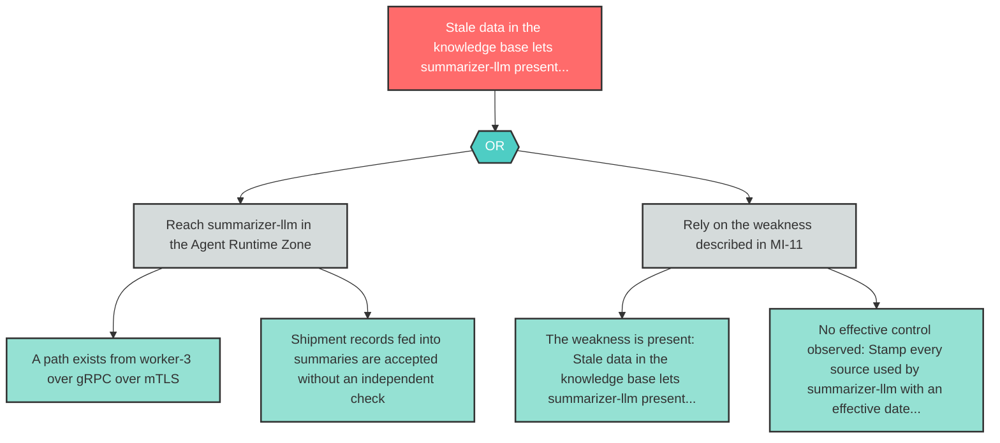

# MI-11: Stale data in the knowledge base lets summarizer-llm present...

**Component**: summarizer-llm | **Risk Level**: Critical | **Finding**: MI-11

Stale data in the knowledge base lets summarizer-llm present superseded tariffs as current, causing wrong quotes.

