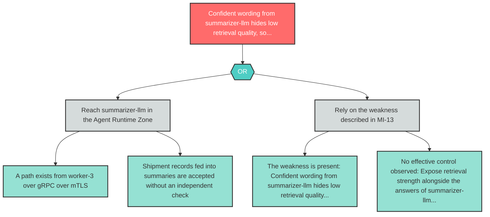

# MI-13: Confident wording from summarizer-llm hides low retrieval quality...

**Component**: summarizer-llm | **Risk Level**: Critical | **Finding**: MI-13

Confident wording from summarizer-llm hides low retrieval quality, so operators cannot tell a grounded answer from a guess.

