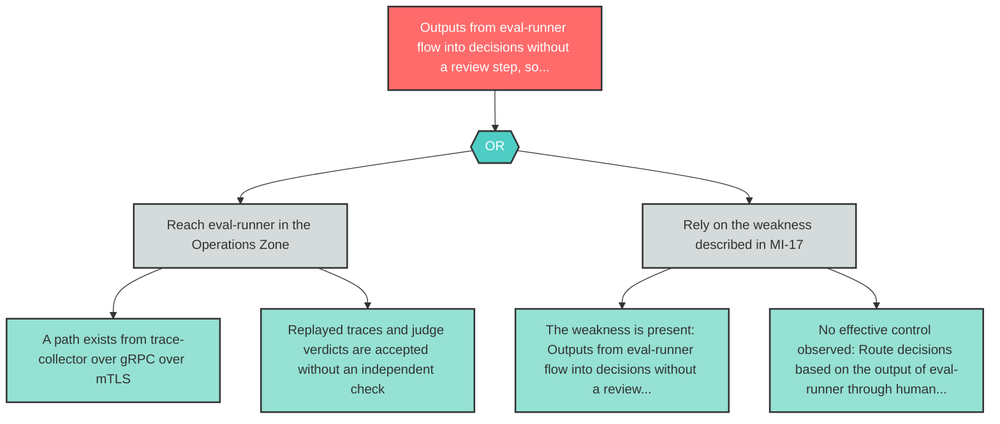

# MI-17: Outputs from eval-runner flow into decisions without a review...

**Component**: eval-runner | **Risk Level**: High | **Finding**: MI-17

Outputs from eval-runner flow into decisions without a review step, so one wrong answer is repeated across many shipments.

