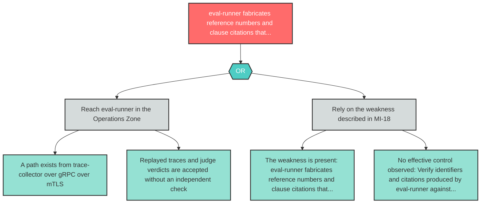

# MI-18: eval-runner fabricates reference numbers and clause citations that...

**Component**: eval-runner | **Risk Level**: High | **Finding**: MI-18

eval-runner fabricates reference numbers and clause citations that look real, which operators then paste into official documents.

