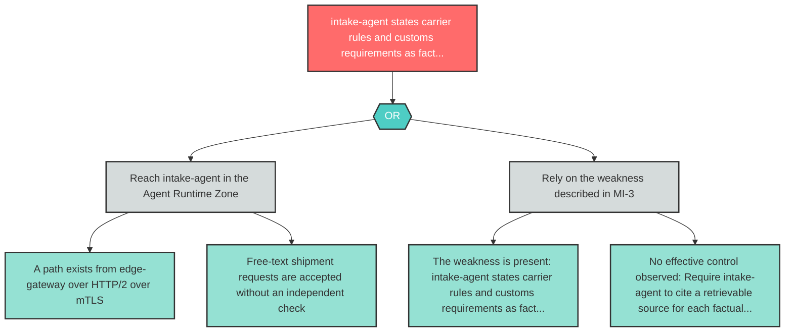

# MI-3: intake-agent states carrier rules and customs requirements as fact...

**Component**: intake-agent | **Risk Level**: Critical | **Finding**: MI-3

intake-agent states carrier rules and customs requirements as fact without grounding them in a cited source, so an operator may act on an invented rule.

