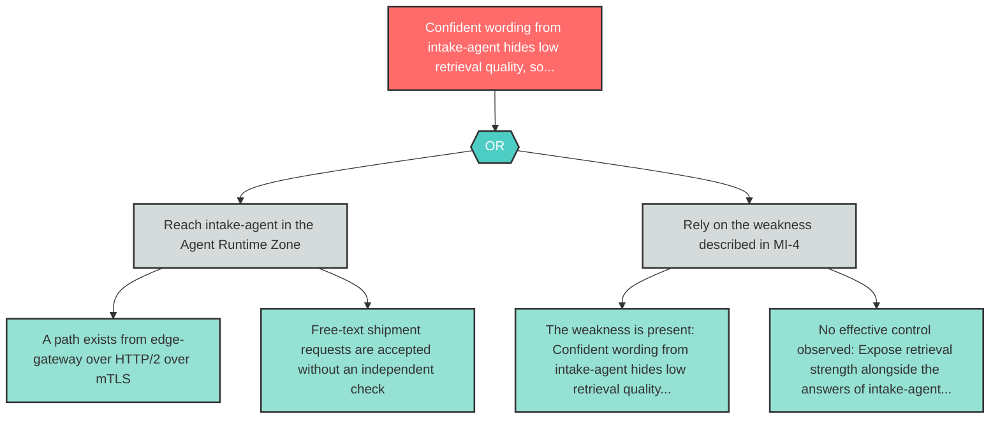

# MI-4: Confident wording from intake-agent hides low retrieval quality...

**Component**: intake-agent | **Risk Level**: Critical | **Finding**: MI-4

Confident wording from intake-agent hides low retrieval quality, so operators cannot tell a grounded answer from a guess.

