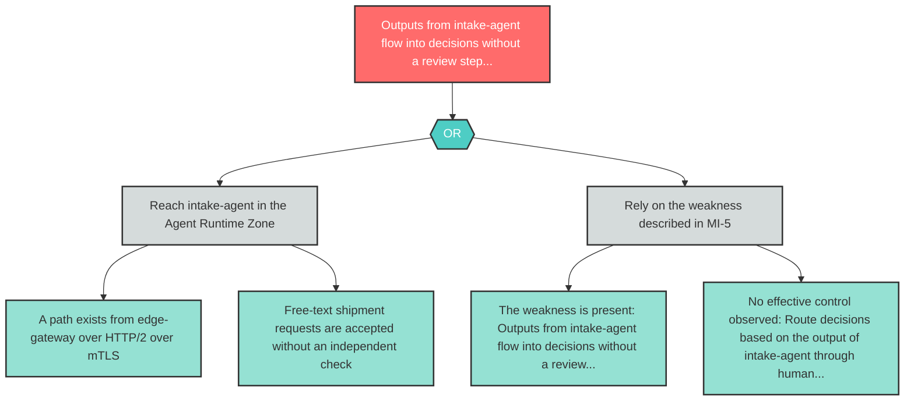

# MI-5: Outputs from intake-agent flow into decisions without a review...

**Component**: intake-agent | **Risk Level**: High | **Finding**: MI-5

Outputs from intake-agent flow into decisions without a review step, so one wrong answer is repeated across many shipments.

