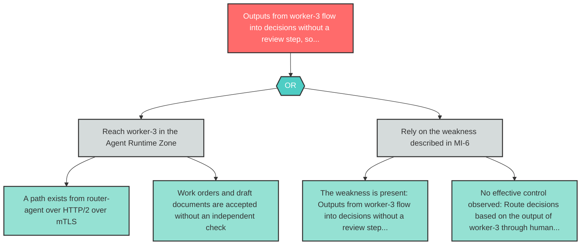

# MI-6: Outputs from worker-3 flow into decisions without a review step...

**Component**: worker-3 | **Risk Level**: High | **Finding**: MI-6

Outputs from worker-3 flow into decisions without a review step, so one wrong answer is repeated across many shipments.

