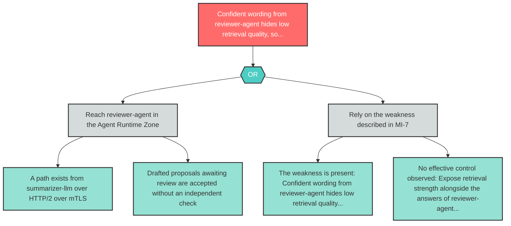

# MI-7: Confident wording from reviewer-agent hides low retrieval quality...

**Component**: reviewer-agent | **Risk Level**: High | **Finding**: MI-7

Confident wording from reviewer-agent hides low retrieval quality, so operators cannot tell a grounded answer from a guess.

