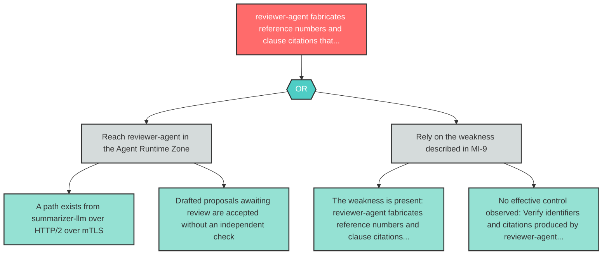

# MI-9: reviewer-agent fabricates reference numbers and clause citations...

**Component**: reviewer-agent | **Risk Level**: High | **Finding**: MI-9

reviewer-agent fabricates reference numbers and clause citations that look real, which operators then paste into official documents.

