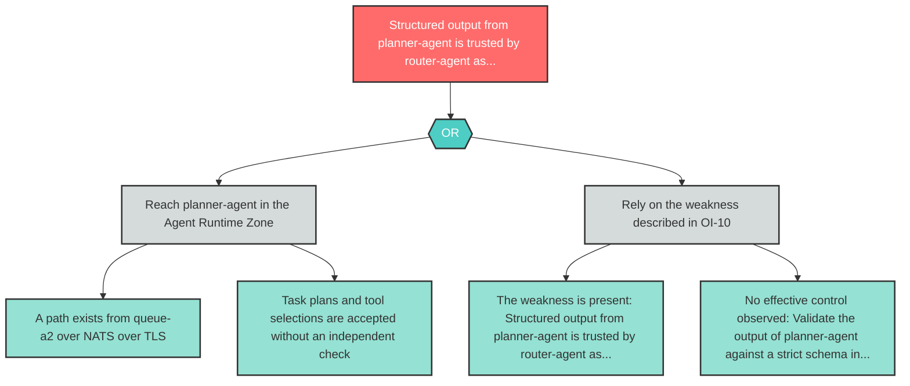

# OI-10: Structured output from planner-agent is trusted by router-agent as...

**Component**: planner-agent | **Risk Level**: Critical | **Finding**: OI-10

Structured output from planner-agent is trusted by router-agent as already validated, so a malformed field flows straight into business logic.

