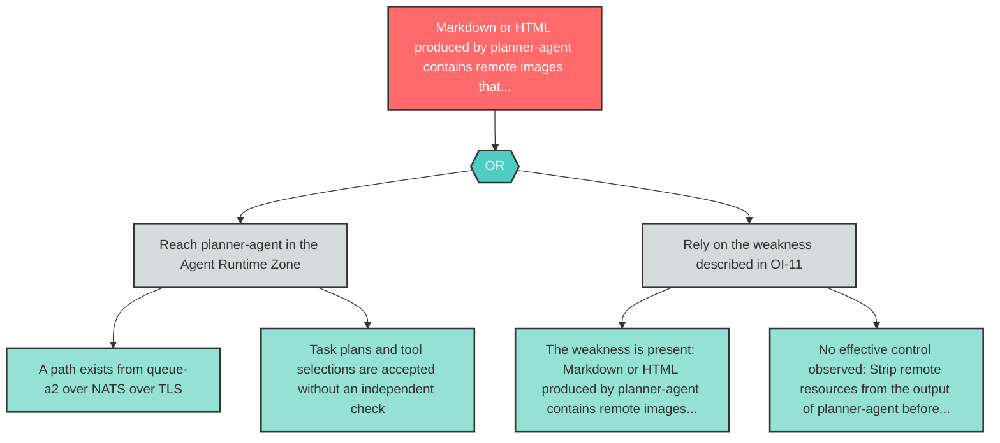

# OI-11: Markdown or HTML produced by planner-agent contains remote images...

**Component**: planner-agent | **Risk Level**: High | **Finding**: OI-11

Markdown or HTML produced by planner-agent contains remote images that leak data when a client renders it.

