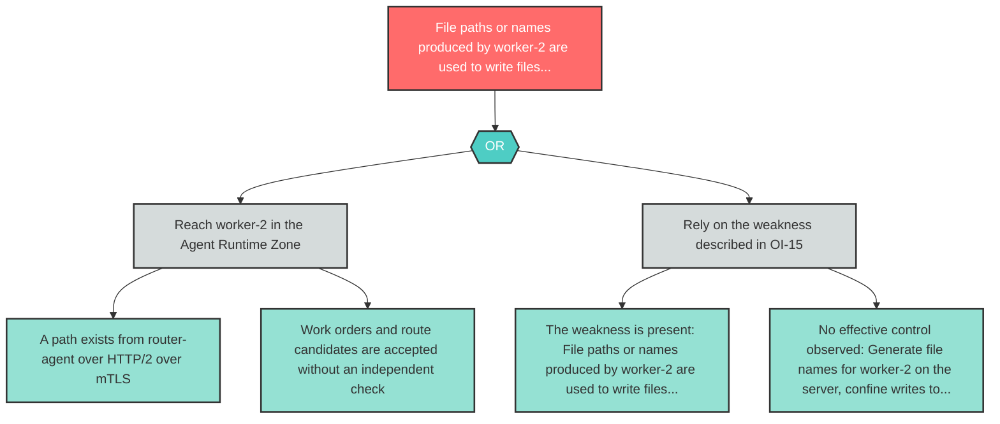

# OI-15: File paths or names produced by worker-2 are used to write files...

**Component**: worker-2 | **Risk Level**: Critical | **Finding**: OI-15

File paths or names produced by worker-2 are used to write files, letting crafted output reach locations outside the intended directory.

