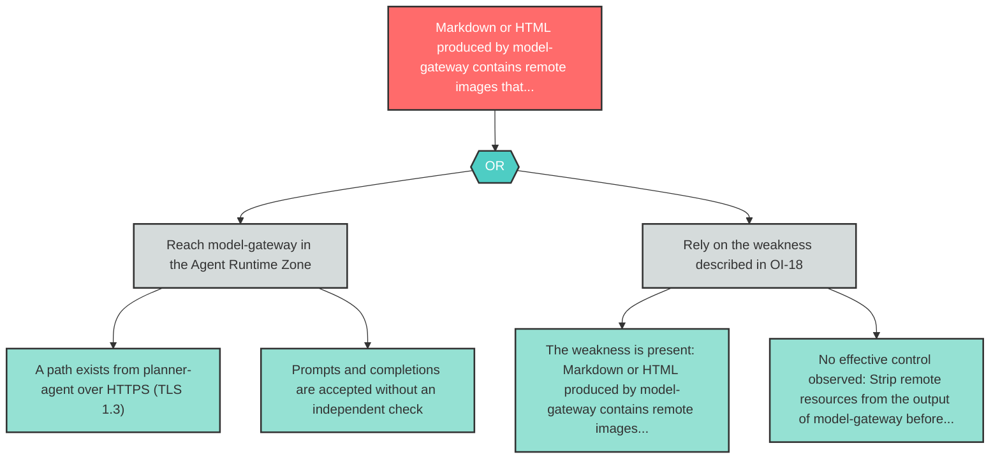

# OI-18: Markdown or HTML produced by model-gateway contains remote images...

**Component**: model-gateway | **Risk Level**: High | **Finding**: OI-18

Markdown or HTML produced by model-gateway contains remote images that leak data when a client renders it.

