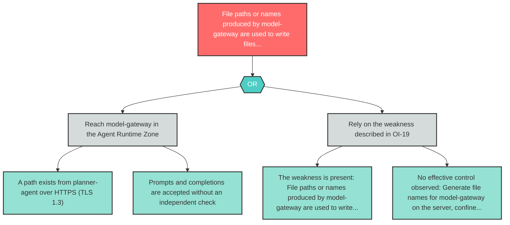

# OI-19: File paths or names produced by model-gateway are used to write...

**Component**: model-gateway | **Risk Level**: High | **Finding**: OI-19

File paths or names produced by model-gateway are used to write files, letting crafted output reach locations outside the intended directory.

