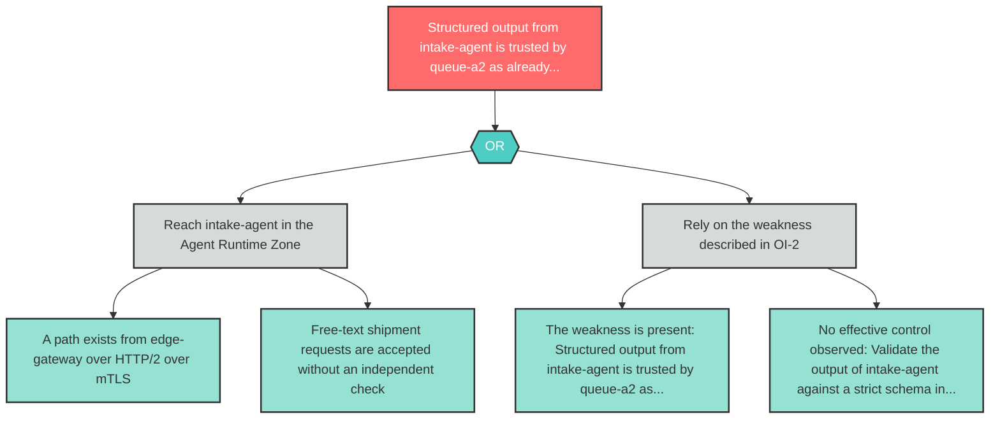

# OI-2: Structured output from intake-agent is trusted by queue-a2 as...

**Component**: intake-agent | **Risk Level**: High | **Finding**: OI-2

Structured output from intake-agent is trusted by queue-a2 as already validated, so a malformed field flows straight into business logic.

