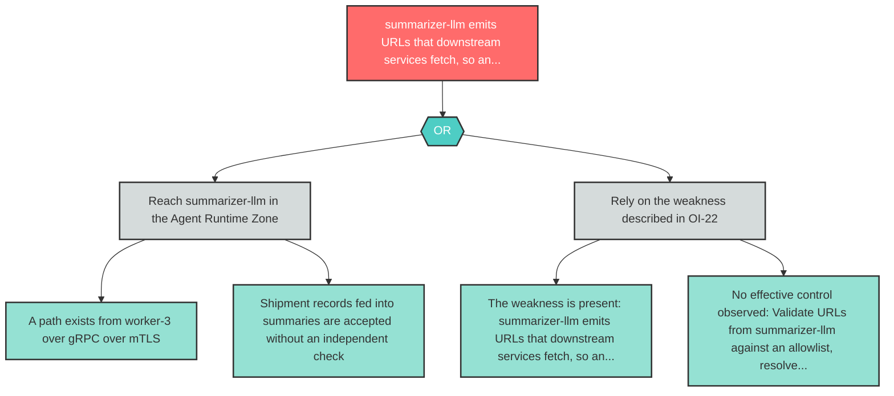

# OI-22: summarizer-llm emits URLs that downstream services fetch, so an...

**Component**: summarizer-llm | **Risk Level**: High | **Finding**: OI-22

summarizer-llm emits URLs that downstream services fetch, so an attacker can make internal addresses part of the output and trigger server-side requests.

