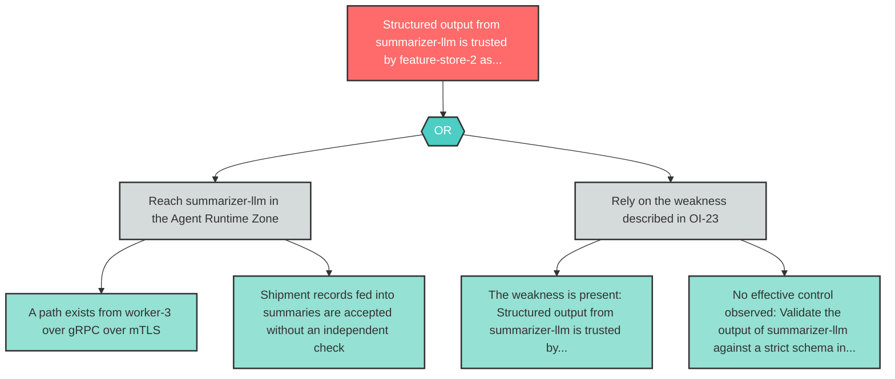

# OI-23: Structured output from summarizer-llm is trusted by...

**Component**: summarizer-llm | **Risk Level**: High | **Finding**: OI-23

Structured output from summarizer-llm is trusted by feature-store-2 as already validated, so a malformed field flows straight into business logic.

