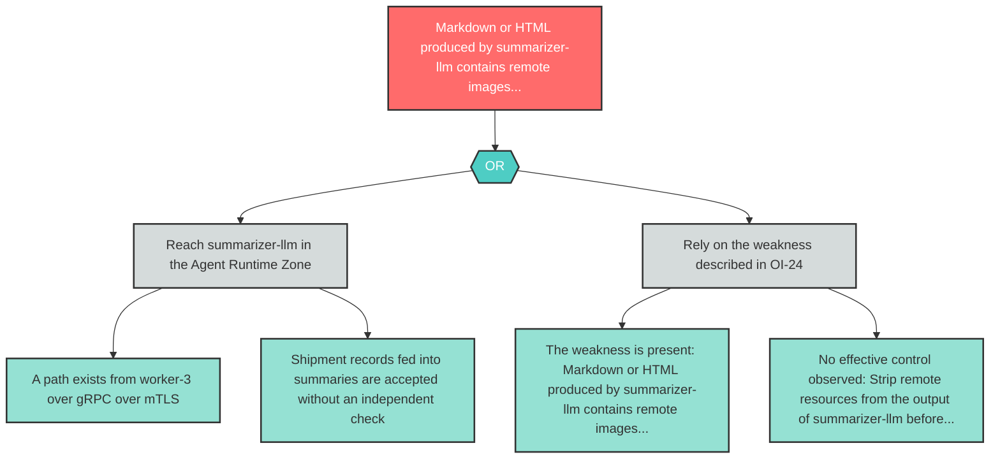

# OI-24: Markdown or HTML produced by summarizer-llm contains remote images...

**Component**: summarizer-llm | **Risk Level**: High | **Finding**: OI-24

Markdown or HTML produced by summarizer-llm contains remote images that leak data when a client renders it.

