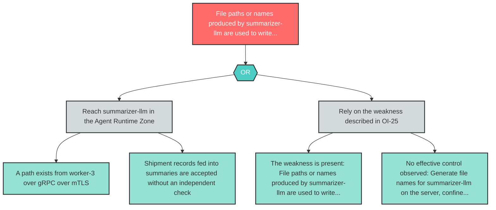

# OI-25: File paths or names produced by summarizer-llm are used to write...

**Component**: summarizer-llm | **Risk Level**: High | **Finding**: OI-25

File paths or names produced by summarizer-llm are used to write files, letting crafted output reach locations outside the intended directory.

