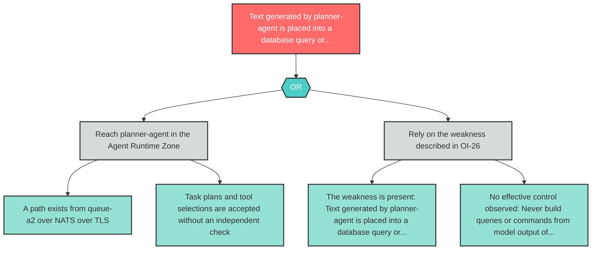

# OI-26: Text generated by planner-agent is placed into a database query or...

**Component**: planner-agent | **Risk Level**: High | **Finding**: OI-26

Text generated by planner-agent is placed into a database query or shell argument without parameterisation, allowing the model to be steered into injection.

