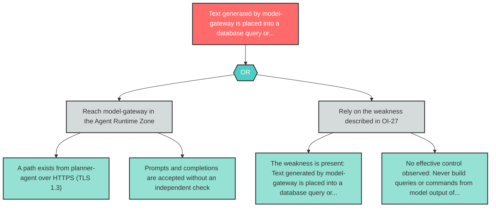

# OI-27: Text generated by model-gateway is placed into a database query or...

**Component**: model-gateway | **Risk Level**: Critical | **Finding**: OI-27

Text generated by model-gateway is placed into a database query or shell argument without parameterisation, allowing the model to be steered into injection.

