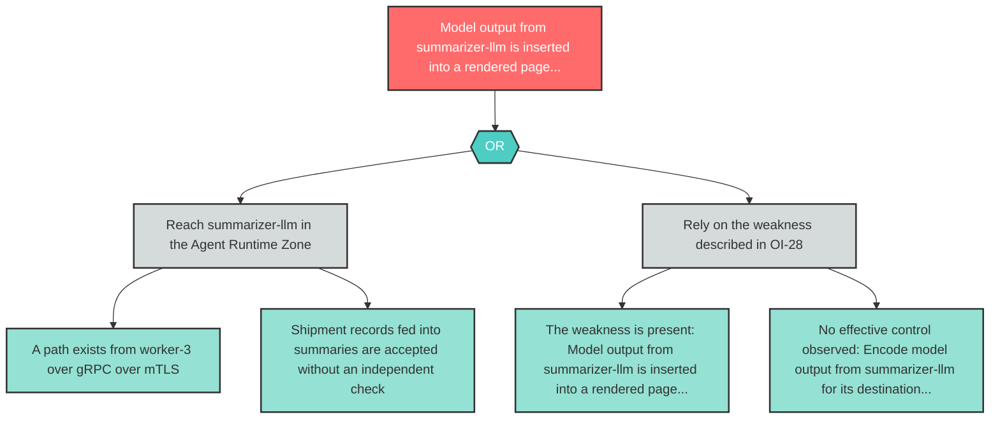

# OI-28: Model output from summarizer-llm is inserted into a rendered page...

**Component**: summarizer-llm | **Risk Level**: High | **Finding**: OI-28

Model output from summarizer-llm is inserted into a rendered page without encoding, so crafted output executes script in an operator's browser.

