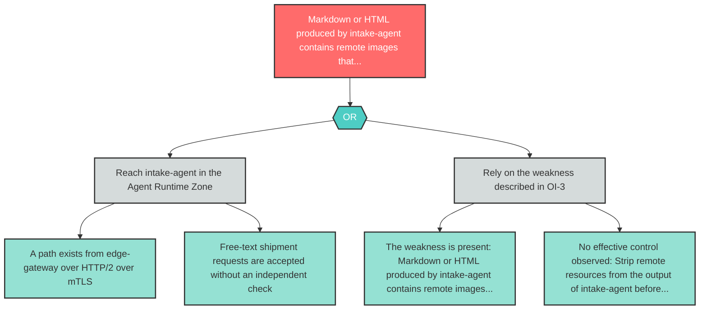

# OI-3: Markdown or HTML produced by intake-agent contains remote images...

**Component**: intake-agent | **Risk Level**: High | **Finding**: OI-3

Markdown or HTML produced by intake-agent contains remote images that leak data when a client renders it.

