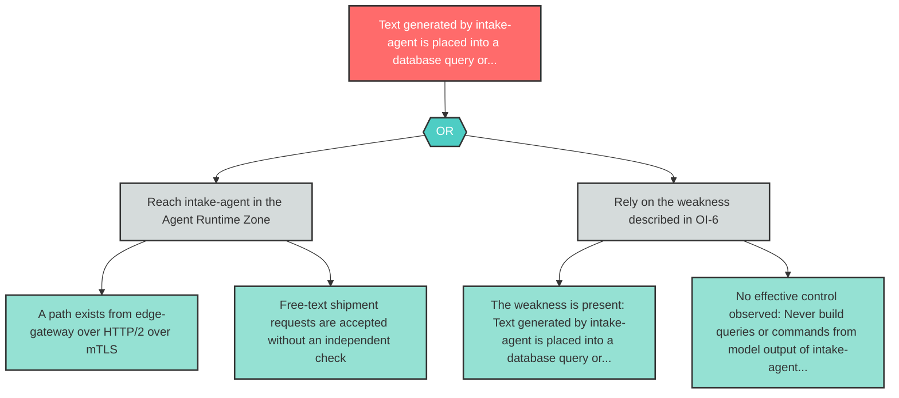

# OI-6: Text generated by intake-agent is placed into a database query or...

**Component**: intake-agent | **Risk Level**: High | **Finding**: OI-6

Text generated by intake-agent is placed into a database query or shell argument without parameterisation, allowing the model to be steered into injection.

