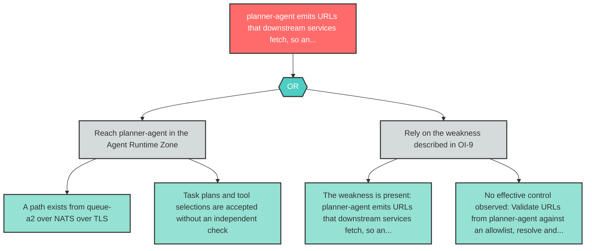

# OI-9: planner-agent emits URLs that downstream services fetch, so an...

**Component**: planner-agent | **Risk Level**: Critical | **Finding**: OI-9

planner-agent emits URLs that downstream services fetch, so an attacker can make internal addresses part of the output and trigger server-side requests.

