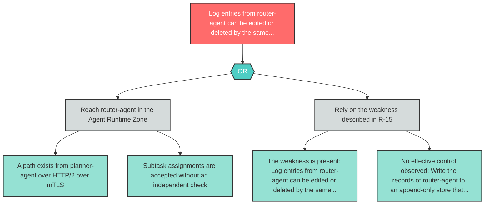

# R-15: Log entries from router-agent can be edited or deleted by the same...

**Component**: router-agent | **Risk Level**: High | **Finding**: R-15

Log entries from router-agent can be edited or deleted by the same operators who administer it, so evidence of misuse can be removed after the fact.

