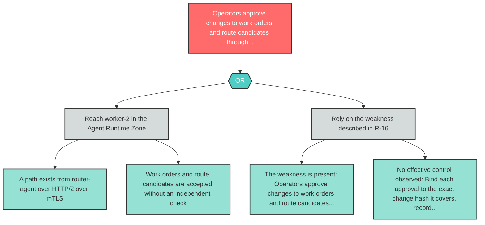

# R-16: Operators approve changes to work orders and route candidates...

**Component**: worker-2 | **Risk Level**: Critical | **Finding**: R-16

Operators approve changes to work orders and route candidates through a chat message or ticket comment that is not bound to the executed change, so approvals can be disputed.

