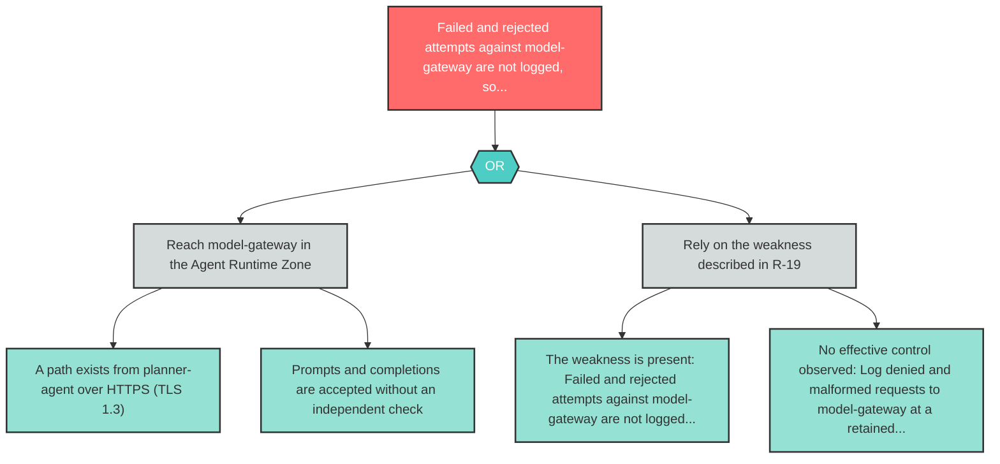

# R-19: Failed and rejected attempts against model-gateway are not logged...

**Component**: model-gateway | **Risk Level**: High | **Finding**: R-19

Failed and rejected attempts against model-gateway are not logged, so probing of prompts and completions leaves no trace that an investigator could use.

