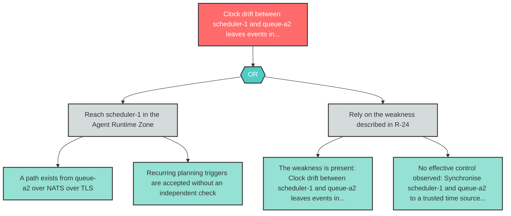

# R-24: Clock drift between scheduler-1 and queue-a2 leaves events in...

**Component**: scheduler-1 | **Risk Level**: High | **Finding**: R-24

Clock drift between scheduler-1 and queue-a2 leaves events in inconsistent order, so the sequence of actions on recurring planning triggers cannot be reconstructed reliably.

