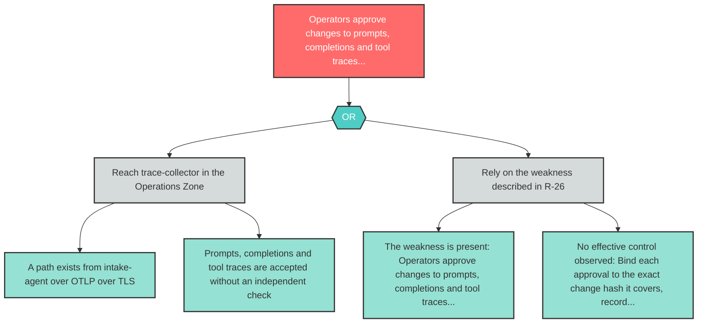

# R-26: Operators approve changes to prompts, completions and tool traces...

**Component**: trace-collector | **Risk Level**: High | **Finding**: R-26

Operators approve changes to prompts, completions and tool traces through a chat message or ticket comment that is not bound to the executed change, so approvals can be disputed.

