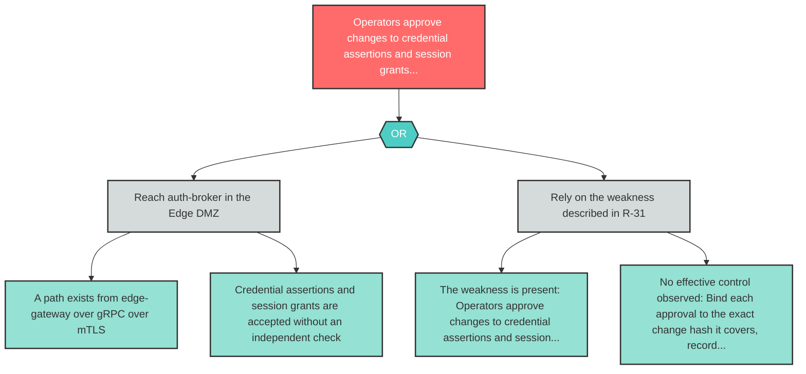

# R-31: Operators approve changes to credential assertions and session...

**Component**: auth-broker | **Risk Level**: High | **Finding**: R-31

Operators approve changes to credential assertions and session grants through a chat message or ticket comment that is not bound to the executed change, so approvals can be disputed.

