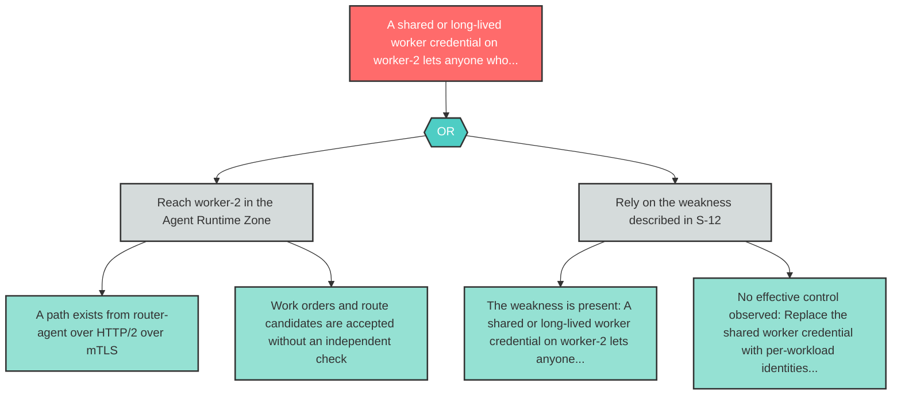

# S-12: A shared or long-lived worker credential on worker-2 lets anyone...

**Component**: worker-2 | **Risk Level**: High | **Finding**: S-12

A shared or long-lived worker credential on worker-2 lets anyone who obtains one copy authenticate as every tenant that uses the same deployment profile.

