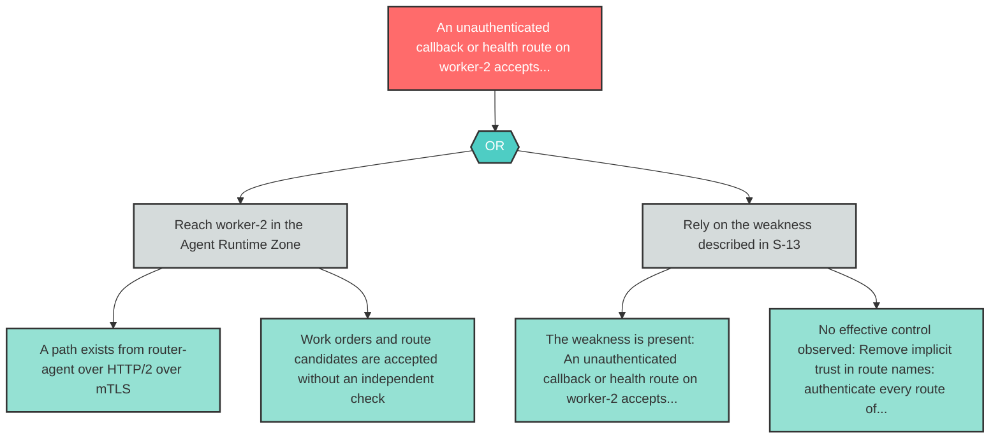

# S-13: An unauthenticated callback or health route on worker-2 accepts...

**Component**: worker-2 | **Risk Level**: High | **Finding**: S-13

An unauthenticated callback or health route on worker-2 accepts requests that downstream code treats as if they had come from trace-collector.

