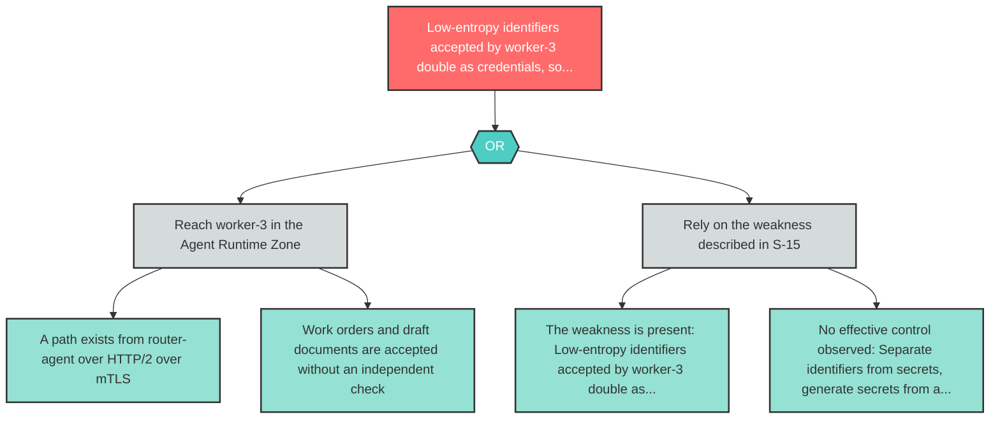

# S-15: Low-entropy identifiers accepted by worker-3 double as...

**Component**: worker-3 | **Risk Level**: High | **Finding**: S-15

Low-entropy identifiers accepted by worker-3 double as credentials, so an attacker who enumerates them submits requests under a victim's identity.

