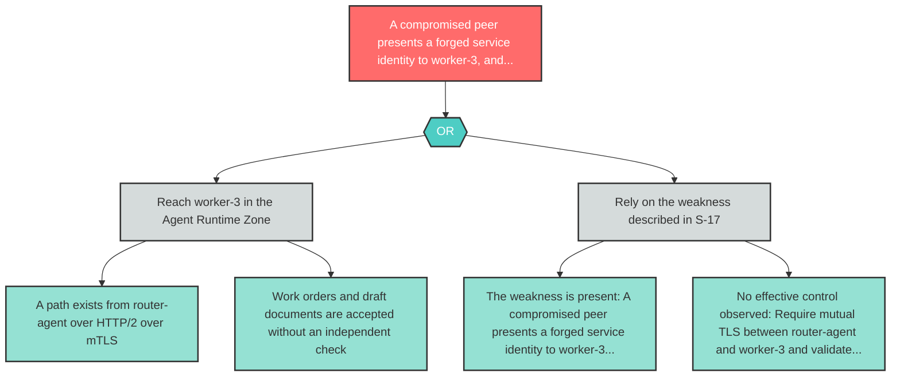

# S-17: A compromised peer presents a forged service identity to worker-3...

**Component**: worker-3 | **Risk Level**: High | **Finding**: S-17

A compromised peer presents a forged service identity to worker-3, and worker-3 accepts the claim without verifying the signature chain back to the issuing authority.

