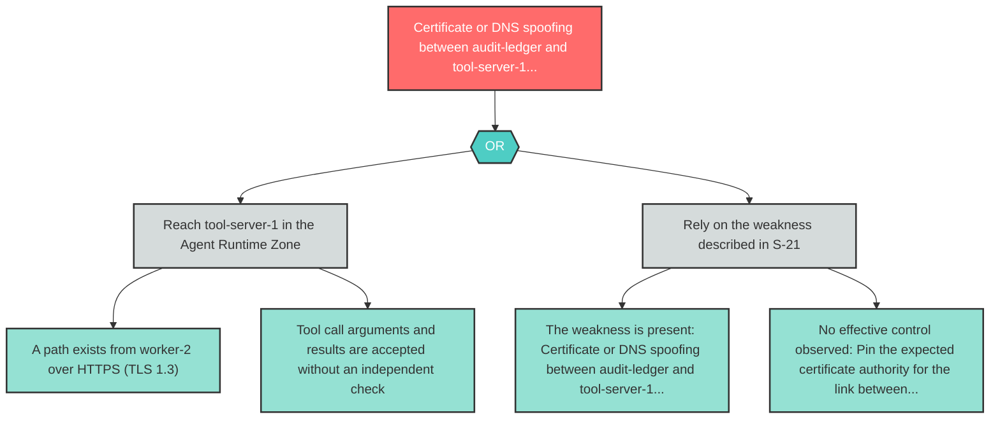

# S-21: Certificate or DNS spoofing between audit-ledger and tool-server-1...

**Component**: tool-server-1 | **Risk Level**: High | **Finding**: S-21

Certificate or DNS spoofing between audit-ledger and tool-server-1 lets an attacker terminate the connection and present a lookalike endpoint when pinning is absent.

