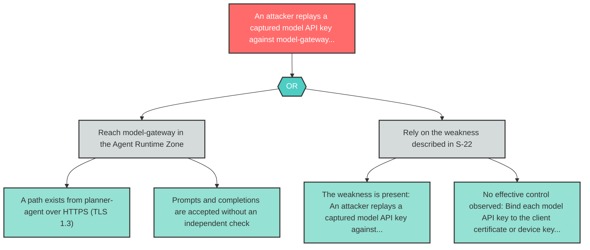

# S-22: An attacker replays a captured model API key against...

**Component**: model-gateway | **Risk Level**: High | **Finding**: S-22

An attacker replays a captured model API key against model-gateway, which does not bind the credential to the session or channel it was issued for, so the replay is accepted as the original caller.

