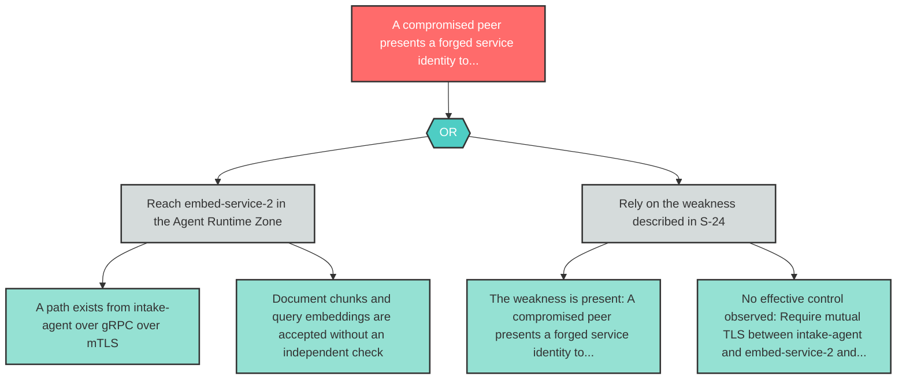

# S-24: A compromised peer presents a forged service identity to...

**Component**: embed-service-2 | **Risk Level**: High | **Finding**: S-24

A compromised peer presents a forged service identity to embed-service-2, and embed-service-2 accepts the claim without verifying the signature chain back to the issuing authority.

