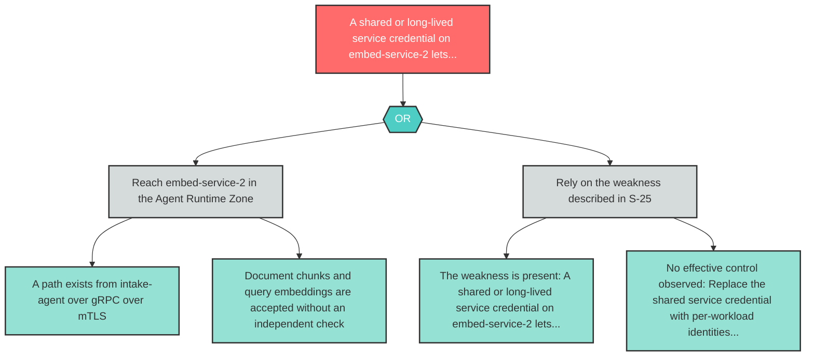

# S-25: A shared or long-lived service credential on embed-service-2 lets...

**Component**: embed-service-2 | **Risk Level**: Critical | **Finding**: S-25

A shared or long-lived service credential on embed-service-2 lets anyone who obtains one copy authenticate as every tenant that uses the same deployment profile.

