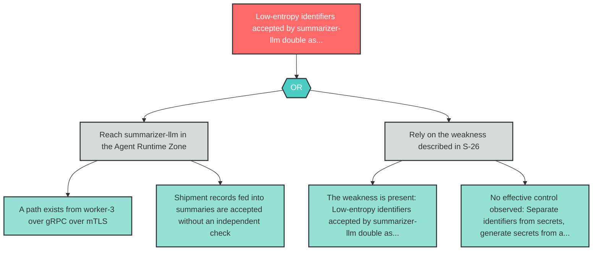

# S-26: Low-entropy identifiers accepted by summarizer-llm double as...

**Component**: summarizer-llm | **Risk Level**: High | **Finding**: S-26

Low-entropy identifiers accepted by summarizer-llm double as credentials, so an attacker who enumerates them submits requests under a victim's identity.

