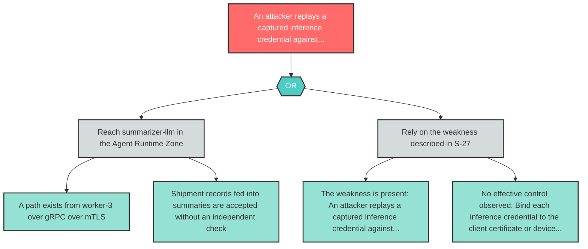

# S-27: An attacker replays a captured inference credential against...

**Component**: summarizer-llm | **Risk Level**: High | **Finding**: S-27

An attacker replays a captured inference credential against summarizer-llm, which does not bind the credential to the session or channel it was issued for, so the replay is accepted as the original caller.

