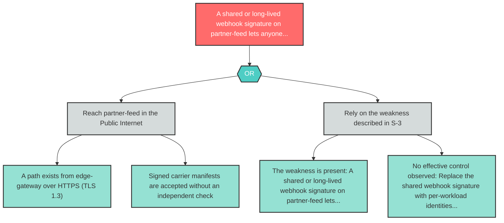

# S-3: A shared or long-lived webhook signature on partner-feed lets...

**Component**: partner-feed | **Risk Level**: High | **Finding**: S-3

A shared or long-lived webhook signature on partner-feed lets anyone who obtains one copy authenticate as every tenant that uses the same deployment profile.

