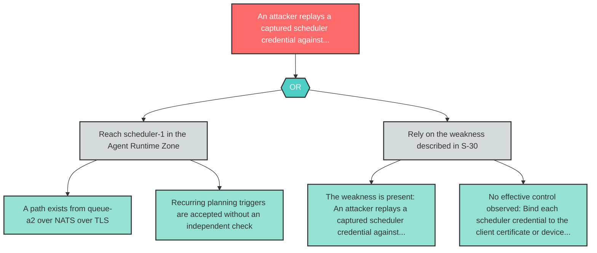

# S-30: An attacker replays a captured scheduler credential against...

**Component**: scheduler-1 | **Risk Level**: Critical | **Finding**: S-30

An attacker replays a captured scheduler credential against scheduler-1, which does not bind the credential to the session or channel it was issued for, so the replay is accepted as the original caller.

