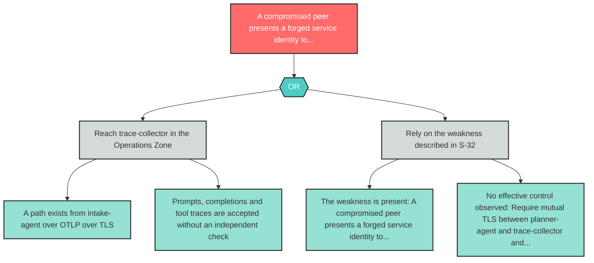

# S-32: A compromised peer presents a forged service identity to...

**Component**: trace-collector | **Risk Level**: High | **Finding**: S-32

A compromised peer presents a forged service identity to trace-collector, and trace-collector accepts the claim without verifying the signature chain back to the issuing authority.

