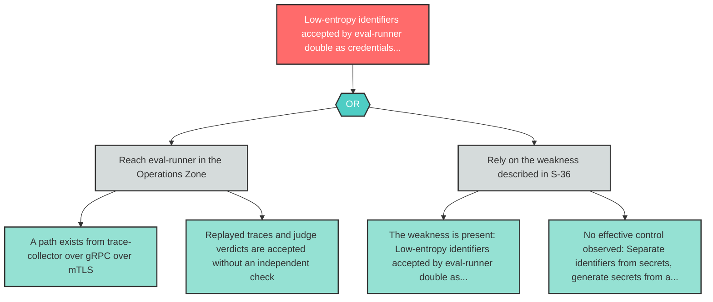

# S-36: Low-entropy identifiers accepted by eval-runner double as...

**Component**: eval-runner | **Risk Level**: Critical | **Finding**: S-36

Low-entropy identifiers accepted by eval-runner double as credentials, so an attacker who enumerates them submits requests under a victim's identity.

